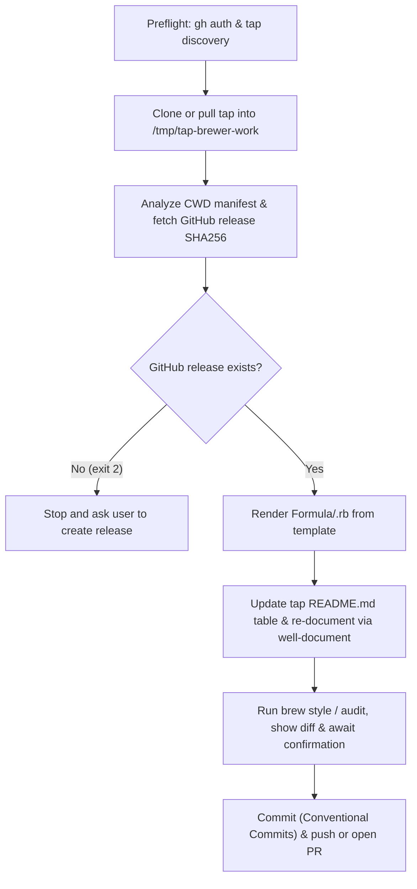

# tap-brewer

[](https://github.com/AtaCanYmc/tap-brewer/actions/workflows/ci.yml)
[](LICENSE)

An open-source AI agent skill that publishes the project in your current working directory to a personal Homebrew tap repository (`homebrew-*`), updates the tap `README.md` table, and validates the generated formula.

## Table of Contents

- [Workflow Overview](#workflow-overview)
- [Prerequisites](#prerequisites)
- [Installation](#installation)
- [Usage](#usage)
- [Supported Ecosystems](#supported-ecosystems)
- [Repository Layout](#repository-layout)
- [Local Verification](#local-verification)
- [License](#license)

## Workflow Overview



## Prerequisites

| Tool | Required | Purpose |
| --- | --- | --- |
| `gh` | Yes | Tap discovery, cloning, release lookup, and PR creation |
| `git` | Yes | Managing the isolated tap working copy |
| `curl` | Yes | Downloading GitHub release tag tarballs |
| `shasum` or `sha256sum` | Yes | Computing deterministic SHA256 checksums |
| `python3` (3.9+) | Yes | Running `scripts/refactor_tap_readme.py` with stdlib only |
| `brew` | Optional | Running local `brew style` and `brew audit` checks |
| `well-document` skill | Optional | Re-documenting and polishing the tap repository after formula updates |

Authenticate `gh` before using the skill:

```bash
gh auth login
```

## Installation

Clone this repository into your agent's global skills directory.

### Google Antigravity / Gemini CLI

```bash
git clone https://github.com/AtaCanYmc/tap-brewer.git ~/.gemini/config/skills/tap-brewer
```

### Claude Code

```bash
git clone https://github.com/AtaCanYmc/tap-brewer.git ~/.claude/skills/tap-brewer
```

### Codex

```bash
git clone https://github.com/AtaCanYmc/tap-brewer.git ~/.codex/skills/tap-brewer
```

### Cursor

```bash
git clone https://github.com/AtaCanYmc/tap-brewer.git ~/.cursor/skills/tap-brewer
```

## Usage

Run your AI coding agent inside any GitHub-hosted project directory that has at least one published release:

```text
Publish this project to my Homebrew tap using tap-brewer.
```

Specify a tap or release tag explicitly when needed:

```text
Use tap-brewer to update my formula in AtaCanYmc/homebrew-tap for tag v1.4.0 and open a PR.
```

You can also invoke the helper scripts directly:

```bash
# Fetch latest release tag, archive URL, and SHA256 as JSON
./scripts/fetch_release_info.sh --repo owner/project

# Insert or update a formula row in a tap README.md
python3 ./scripts/refactor_tap_readme.py \
  --readme /path/to/homebrew-tap/README.md \
  --formula my-cli \
  --description "Inspect local build caches from the terminal" \
  --tap owner/tap \
  --source https://github.com/owner/my-cli
```

## Supported Ecosystems

| Ecosystem | Detection File | Formula Strategy | Template |
| --- | --- | --- | --- |
| Python | `pyproject.toml` | `Language::Python::Virtualenv` and `virtualenv_install_with_resources` | [`templates/python.rb.tmpl`](templates/python.rb.tmpl) |
| Go | `go.mod` | `go build` with `std_go_args(ldflags: "-s -w")` | [`templates/go.rb.tmpl`](templates/go.rb.tmpl) |
| Node.js | `package.json` | `npm install` with `std_npm_args` and `bin.install_symlink` | [`templates/node.rb.tmpl`](templates/node.rb.tmpl) |
| Shell | Standalone script | Direct `bin.install` mapping | [`templates/shell.rb.tmpl`](templates/shell.rb.tmpl) |
| Rust | `Cargo.toml` | `cargo install` with `std_cargo_args` | Inline in [`SKILL.md`](SKILL.md) |

## Repository Layout

```text
tap-brewer/
├── .github/
│   ├── CODEOWNERS
│   ├── dependabot.yml
│   ├── ISSUE_TEMPLATE/
│   │   ├── bug_report.yml
│   │   ├── config.yaml
│   │   └── feature_request.yml
│   ├── PULL_REQUEST_TEMPLATE/
│   │   └── pull_request_template.md
│   └── workflows/
│       ├── ci.yml
│       ├── owner-auto-merge.yml
│       └── release-please.yml
├── .editorconfig
├── .gitattributes
├── .gitignore
├── .markdownlint.json
├── .release-please-manifest.json
├── CONTRIBUTING.md
├── LICENSE
├── Makefile
├── README.md
├── ROADMAP.md
├── SECURITY.md
├── SKILL.md
├── release-please-config.json
├── scripts/
│   ├── fetch_release_info.sh
│   └── refactor_tap_readme.py
├── templates/
│   ├── go.rb.tmpl
│   ├── node.rb.tmpl
│   ├── python.rb.tmpl
│   └── shell.rb.tmpl
└── tests/
    └── test_tap_brewer.py
```

## Local Verification

Run the full lint and test suite with Make:

```bash
make check
```

Or run the unit tests directly with Python 3:

```bash
python3 -m unittest discover -s tests -v
```

## License

MIT. See [LICENSE](LICENSE).
