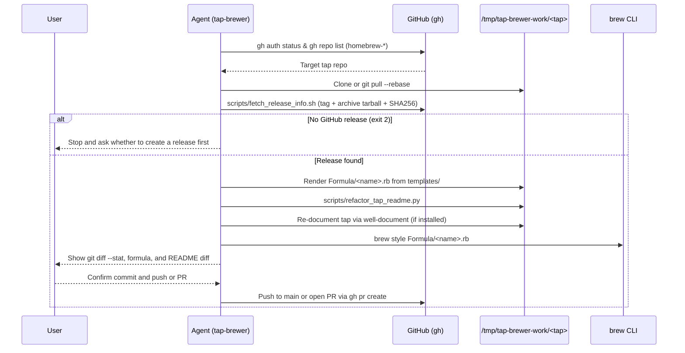

[← Back to Docs Index](README.md)

# Publishing Workflow

`tap-brewer` executes a deterministic five-step pipeline that isolates all git mutations inside `/tmp/tap-brewer-work/<tap-repo-name>` and leaves the user's project working directory untouched.

## Table of Contents

- [Execution Sequence](#execution-sequence)
- [Step Details](#step-details)
- [Formula Class Naming](#formula-class-naming)
- [Homebrew Strict Audit Rules](#homebrew-strict-audit-rules)
- [Commit and Push Policy](#commit-and-push-policy)

## Execution Sequence

## Step Details

1. **Preflight and Tap Discovery**: Verifies `gh auth status`. If no tap repository is specified, queries `gh repo list` for `homebrew-*` repositories, auto-selects when one match exists, or prompts when multiple exist. Clones or rebases into `/tmp/tap-brewer-work/<tap-repo-name>` after checking that the work copy is clean.
2. **Project Analysis**: Detects the ecosystem from CWD manifests (`pyproject.toml`, `go.mod`, `package.json`, `Cargo.toml`, or standalone shell script), extracts metadata, and invokes `scripts/fetch_release_info.sh`. Stops immediately on exit code `2` when no GitHub release exists.
3. **Formula Generation or Update**: Renders `Formula/<name>.rb` from the matching template in `templates/`. Preserves custom `resource`, `caveats`, or `patch` blocks when updating an existing formula.
4. **Tap Refactoring and Re-Documentation**: Updates the tap's `README.md` table with `scripts/refactor_tap_readme.py`, applies `well-document` (`polish` and `audit`) to keep tap documentation grounded without scaffolding unrequested files, and runs `brew style` when `brew` is installed.
5. **Review, Commit, and Push**: Displays `git diff --stat`, the formula, and documentation diffs. Waits for explicit confirmation before committing and pushing to `main` or opening a pull request with `gh pr create`.

## Formula Class Naming

| Formula Name | Ruby Class Name | Rule |
| --- | --- | --- |
| `my-cli-tool` | `MyCliTool` | Split on `-`, capitalize each segment, join |
| `foo_bar` | `FooBar` | Split on `_`, capitalize each segment, join |
| `tool@2` | `ToolAT2` | Convert `@` version suffix to `AT` |

## Homebrew Strict Audit Rules

| Field | Requirement |
| --- | --- |
| `desc` | Under 80 characters, no trailing period, does not start with formula name or `A` / `An` / `The` |
| `homepage` | Valid `https://` URL |
| `url` | Canonical `https://github.com/<owner>/<repo>/archive/refs/tags/<tag>.tar.gz` archive URL |
| `sha256` | Exact 64-character lowercase hex digest computed from the downloaded tarball |
| `license` | Valid SPDX identifier such as `MIT` or `Apache-2.0` |
| Stanza order | `desc`, `homepage`, `url`, `sha256`, `license`, `depends_on`, `resource`, `def install`, `test do` |

## Commit and Push Policy

- New formula: `feat(formula): add <name> <version>`
- Formula bump: `chore(formula): bump <name> to <version>`
- Force-push (`--force` or `--force-with-lease`) is prohibited.
- CWD repository files and tags are never modified unless explicitly requested.
